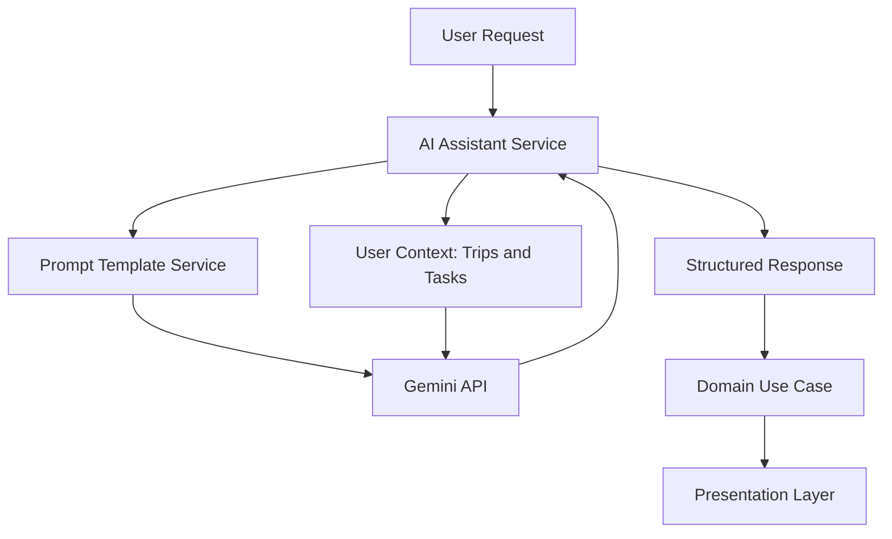

# AI Features

## Document Information

| Field | Value |
| --- | --- |
| Document | AI Features |
| Status | Draft |
| Version | 1.2.0 |
| Last Updated | 2026-10-28 |
| Owner | Engineering – AI |

## Table of Contents

- [Purpose](#purpose)
- [Feature Overview](#feature-overview)
- [AI Capabilities](#ai-capabilities)
- [Data Requirements](#data-requirements)
- [Model Considerations](#model-considerations)
- [Limitations](#limitations)
- [Notes](#notes)

## Purpose

This document defines how AI, powered by the Gemini API, is integrated across LifeOS. It implements the [AI Integration Rules](../CLAUDE.md#ai-integration-rules) defined in `CLAUDE.md` and provides the detail behind the AI-related requirements in [07-functional-requirements.md](07-functional-requirements.md#ai-assistant).

## Feature Overview

AI in LifeOS is not confined to a single chat screen. It is a cross-cutting capability surfaced in four places:

| Surface | Behavior |
| --- | --- |
| AI Assistant (dedicated) | Free-form conversation with the assistant, aware of the user's trips and tasks. |
| Home Dashboard | A short, AI-curated highlight summarizing what matters today (FR-HOME-03). |
| Travel | AI-generated itinerary suggestions for a trip (FR-TRAVEL-05). |
| Planner | AI-assisted task suggestions surfaced through the AI Assistant when invoked from the Task List. |

## AI Capabilities

| Capability | Description |
| --- | --- |
| Conversational assistance | Users can ask free-form questions and receive contextual answers. |
| Trip itinerary suggestions | Given a trip's destination and dates, the assistant proposes itinerary items the user can accept or discard. |
| Task-aware daily highlight | The assistant summarizes the user's day using their tasks and trips as input. |
| Suggestion application | Accepted suggestions are converted into real Trip/ItineraryItem or Task records through the normal domain use cases — never written directly by the AI layer. |

### Daily Brief on mobile

The AI Assistant screen opens with a "Günün Özeti" card built from **one** backend call, `POST /api/v1/daily-brief/overview`, which returns all four parts from a single AI request (one request instead of four keeps the card within the AI provider's free-tier quota):

| `result` field | Shown as |
| --- | --- |
| `summary` | "Bugünün odağı" (`suggestedFocus`) and "Öne çıkanlar" (`keyEvents`) |
| `priorities` | "Önerilen sıra": tasks ordered by `suggestedRank`, each with its `reason`; an empty array means there is nothing to rank today |
| `motivation` | "Günün motivasyonu" (`message`) |
| `reminders` | "Hatırlatma önerileri": each suggestion's title, reason and suggested date, with an "Ajandaya ekle" button; hidden when `null` or empty |

- The backend checks each part on its own and sends `null` for a part the AI got wrong; the other parts still show, with a note that the brief is incomplete. The card shows an error only when the request fails or all four parts are `null`. `reminders` is optional: when only it is missing, the brief still counts as complete (no note, cached for the day).
- "Ajandaya ekle" saves the suggestion as a Planner task through `AddReminderToAgendaUseCase`, which calls Planner's `CreateTaskUseCase`: due on the suggested date (today when there is none or it has passed), `MEDIUM` priority, `TRAVEL` category for travel-related suggestions and `PERSONAL` otherwise, and the reason as the description. It is a normal task: no notification is scheduled (the backend doesn't store `hasReminder` yet; push notifications are planned separately). While saving, the button shows progress; afterwards it turns into a disabled "Eklendi", also after a refresh of the brief, so the same suggestion can't be added twice. A failure shows a snackbar and the button can be tapped again. The AI itself never creates a task. The task context below the card never waits for, or depends on, the AI.
- A complete brief is cached in memory for the current day (`DailyBriefRepositoryImpl`). Switching tabs or returning to the screen does not call the AI again; the refresh button does. A partial brief is not cached, so the next load asks again.
- AI calls use a 60-second client timeout (normal requests use 30 seconds), because the backend may retry a provider and fall back to another before answering.
- The brief is a suggestion only. Its priority order never changes a task's stored priority.
- The backend needs `GEMINI_API_KEY` (or `OPENROUTER_API_KEY`) set; without one, every part fails and the card shows its error message.

### AI chat

A short, **stateless** chat with the assistant: `POST /api/v1/ai/chat` with `{ message, history }` returns `{ reply, remainingMessages }` (see [15-api-design.md](15-api-design.md#ai-chat)).

- **Stateless:** the server stores no conversation. The client sends the recent turns it wants remembered (at most 8, oldest first); the new message is at most 500 characters. Persistent conversation history (`ai_conversations`/`ai_messages`, FR-AI-03) is deferred until after the presentation.
- **Context and tone:** the shared `assistant` prompt template gives the model the user's Planner tasks and Travel trips. Replies are in Turkish and short (at most 4 sentences), and address the user informally with "sen". The assistant only suggests: it never creates, changes, completes or deletes anything, and when asked it explains how the user can do it in the app. It only points to features the app really has today (tasks with title, description, date, time, priority and category; trips and itineraries; the agenda), never to ones it doesn't have or doesn't save yet (e.g. subtasks, alerting reminders or notifications, sharing, attachments).
- **Prompt injection:** the history and the new message are placed after the instructions in clearly delimited `<history>`/`<message>` blocks, labeled as quoted data, and the instructions tell the model to ignore anything in them that tries to change its rules. The block markers are stripped from the user's text, so it can't close a block and pose as instructions.
- **Daily limit:** each user may send `AI_CHAT_DAILY_LIMIT` messages a day (default 5), counted in the user's own time zone (`users.timezone`, default `Europe/Istanbul`), so the limit resets at the user's midnight. The count lives in `ai_chat_usage` (one row per user per day, no message content) and is reserved with a single atomic upsert before the AI call, so concurrent messages can't exceed the limit; if the AI call fails, the message is given back. When the limit is used up the endpoint answers `429` with `code: "CHAT_DAILY_LIMIT_REACHED"`; a `429` without that code means the AI provider's own quota is used up.
- Uses the same Gemini model chain as every other capability (see [12-project-architecture.md](12-project-architecture.md#ai-service-boundaries)).

**On mobile** the chat is a separate "Sohbet" screen (`features/ai/presentation/chat`), opened from the AI Assistant tab ("Asistanla sohbet et") and from Home's "AI Asistanına Sor" quick action.

- User and assistant messages appear as bubbles. The input has a 500-character limit with a counter; "Asistan yazıyor…" shows while a reply is on its way.
- The empty screen offers three example questions; tapping one sends it.
- The conversation lives only in `AiChatViewModel`, for as long as the screen is open. `SendChatMessageUseCase` sends the last 8 successful turns with each message.
- After the first reply the screen shows "Bugün N mesaj hakkın kaldı". When none are left (the reply's `remainingMessages` is 0, or the backend answers `CHAT_DAILY_LIMIT_REACHED`), the input is replaced by "Bugünlük mesaj hakkın doldu, yarın görüşürüz."
- A failed message stays in the list marked "Gönderilemedi", with the reason and a "Tekrar dene" button. A `429` without a code (the AI provider's quota) shows "Bugünlük yapay zeka hakkın doldu, yarın tekrar dene." and keeps the input open.
- Colors come from the theme (dark mode). Screen readers hear who wrote each bubble ("Sen: …", "Asistan: …"); the send button, counter and example questions have their own descriptions, and errors and the typing note are announced.

## Data Requirements

- The AI module reads only the requesting user's own trips, itinerary items, and tasks — no cross-user data is ever included in a prompt.
- Data passed to Gemini is limited to what is relevant to the specific request (e.g., a single trip's destination and dates for itinerary suggestions), not the user's entire history.
- AI chat stores no conversation content, only a per-user daily message count (`ai_chat_usage`). Persisting conversations and messages for AI Conversation History (FR-AI-03, see [14-database-design.md](14-database-design.md#entities)) is planned for after the presentation.

## Model Considerations

- All AI functionality is implemented against the Gemini API, per [CLAUDE.md](../CLAUDE.md#tech-stack).
- The AI integration is isolated behind a dedicated backend module (an "AI module") so the Gemini API is the only integration point with the model provider; no other module calls the Gemini API directly.
- Prompt templates are defined once, stored centrally, and reused across features (e.g., one itinerary-suggestion template used by both the Travel module's AI entry point and the AI Assistant conversation), per [CLAUDE.md](../CLAUDE.md#ai-integration-rules).
- Business logic — deciding what to do with an AI suggestion (e.g., creating an ItineraryItem) — lives in domain use cases, not inside the AI module or the prompt/response handling code.
- The concrete provider-abstraction design, prompt/context management, rate limiting, retry, and circuit-breaker mechanics are defined in [12-project-architecture.md](12-project-architecture.md#ai-integration-architecture).

## Limitations

- The AI Assistant must never directly modify UI state or persisted data; it returns suggestions that flow through the same domain use cases as any user-initiated action, per [CLAUDE.md](../CLAUDE.md#ai-integration-rules).
- AI responses are not treated as guaranteed-accurate; itinerary and task suggestions always require explicit user acceptance before being persisted (FR-AI-04, FR-TRAVEL-05).
- If the Gemini API is unavailable or times out, the AI Assistant surfaces a clear error state; core Travel and Planner functionality must remain usable per [08-non-functional-requirements.md](08-non-functional-requirements.md#reliability) and the error-handling/circuit-breaker strategy in [12-project-architecture.md](12-project-architecture.md#error-handling).

## Notes

Advanced AI capabilities beyond conversational assistance and suggestion generation (e.g., proactive notifications, automatic schedule optimization) are tracked as future phases in [11-roadmap.md](11-roadmap.md), not part of the current AI feature set.
